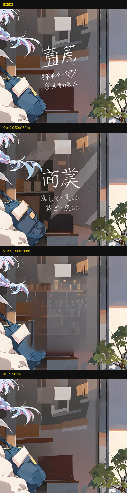
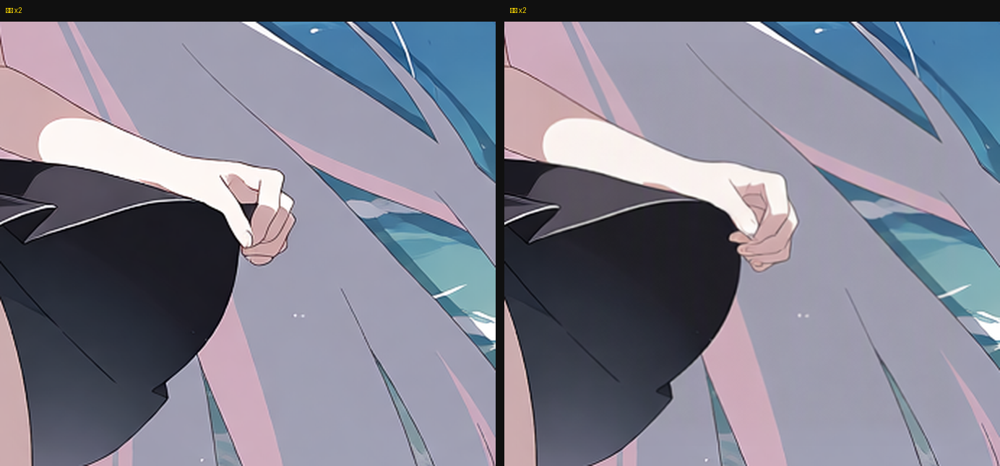

# ComfyUI · 千问局部重绘（Qwen-Image-2.1 Edit）

> 框住一块 → 写一句中文 → 80 秒 → **只重画框里那块**，框外一个像素都不动。

一套跑在本地 ComfyUI 上的**指令式局部重绘**工作流：用千问的图像编辑模型，按你的中文指令改图上任意一块区域，
不需要英文提示词、不需要会画 mask 之外的任何东西。



同一张 2590×1619 的玻璃招牌图、同一个框、同一句需求「把乱码字去掉」：

| 引擎 | 用时 | 框内变化 | 结果 |
|---|---|---|---|
| Krea2（denoise 0.50） | 169 s | 34.1/255 | 把乱码换成了「商業」，**又写了字** |
| MOSS（denoise 0.90） | 180 s | 28.2/255 | 干净，但玻璃后陈列被重画成货架/罐头 |
| **Qwen-Image-2.1 Edit** | **82~90 s** | **16.2/255** | **干净，且原位背景结构基本保留** |

框外平均变化 **0.2/255**（只有羽化环），肉眼不可见。

---

## 功能

- **框选即改**：点节点上的「裁剪图像」拖个框，写一句中文就行（也支持 MaskEditor 手涂，两路取并集）
- **只改框内**：裁切 → 重绘 → 按 mask 羽化回贴，框外零改动
- **AI 帮你说清楚**（可选）：把「左原图 / 右标红框选处」拼成双联图喂视觉模型，你的一句话需求会被改写成可执行指令
  > 你写：`修复手指的结构，保留原有的动作和姿势`
  > AI 改成：`把画面中女孩握拳的手修复成结构正常的五指，保持原有握持姿势、手臂角度、黑色水手服和背景画风不变`
- **多轮修图**：跑完点一下「▶ 设为下一轮输入」，成品自动回填成下一轮输入并清空旧框选，不用下载再导入
- **局部轻锐化**：重绘区域锐度实测只有原图 26%，加一道只作用框内的 `ImageSharpen` 拉回 2.4 倍（可选关掉）
- **界面里填 API**：自带 `qwen_api_config` 插件，`BSK_AIText` 节点上多一个「API 设置」按钮，Key 只落本机、不进工作流



---

## 安装

### 一键（推荐）

```powershell
# 解压后双击 一键安装.bat（国内网络用 一键安装_镜像.bat）
# 或命令行：
powershell -ExecutionPolicy Bypass -File .\install.ps1          # 体检 + 只补装缺的
powershell -ExecutionPolicy Bypass -File .\install.ps1 -Check    # 只体检
```

脚本会：自动找 ComfyUI → 体检（版本 / 节点包 / 模型是否齐全且大小正确）→ **只安装缺失的部分** → 复制工作流 → 打印清单。

完整离线包（含 3 个第三方节点包，约 40 MB）见 [Releases](../../releases)。

### 手动

1. 节点包（3 个）装到 `ComfyUI/custom_nodes/`：
   - [ComfyUI-ZML-Image](https://github.com/zml-w/ComfyUI-ZML-Image)（框选，MIT）
   - [ComfyUI-Inpaint-CropAndStitch](https://github.com/lquesada/ComfyUI-Inpaint-CropAndStitch)（裁切/回贴）
   - [ComfyUI-KJNodes](https://github.com/kijai/ComfyUI-KJNodes)（遮罩羽化）
2. 本仓库的 `custom_nodes/qwen_api_config`、`custom_nodes/qwen_continue` 复制进去
3. 模型（来自 [Comfy-Org/Qwen-Image-2.1](https://huggingface.co/Comfy-Org/Qwen-Image-2.1)，共约 16 GB）：

| 放到 | 文件 |
|---|---|
| `models/diffusion_models/` | `qwen_image_2.1_int8_convrot.safetensors`（6.76 GB） |
| `models/text_encoders/` | `qwen3vl_8b_int8_convrot.safetensors`（8.71 GB） |
| `models/vae/` | `qwen_image_2.1_vae_bf16.safetensors`（0.63 GB） |

4. 把 `workflows/Qwen_局部重绘_基础版_v1.json` 拖进画布，重启 ComfyUI

> ComfyUI ≥ 0.36（本项目在 0.37.0 实测）。8 GB 显存的笔记本显卡即可（4060 Laptop 实测）。

---

## 用法

1. **① 原图** 选图（放 `ComfyUI/input/`）
2. **② 框选** 点「裁剪图像」，拖框（换图后**必须重新框**，坐标是按图存的）
3. **④ 指令** 写中文，例如
   - `把玻璃门上那几行乱码字去掉，让玻璃恢复干净，保留反光和货架`
   - `把这只手修成正常的五指，保留原来的姿势`
4. 运行 → 看 **⑦ 成品 / 裁切重绘 / 遮罩**

多轮修改：跑完点 **⑧ 继续修改 →「▶ 设为下一轮输入」**，再重新框一处、改指令、运行。

---

## 参数

| 参数 | 位置 | 默认 | 说明 |
|---|---|---|---|
| `resolution` | 编码节点 | **0** | 0 = 跟裁切尺寸，别乱改（改了编辑会飘） |
| `steps` / `cfg` | KSampler | 40 / 1.0 | 千问官方设置 |
| `denoise` | KSampler | **1.0** | 指令编辑要 1.0 |
| `context_from_mask_extend_factor` | 裁切 | 2.5 | 手/眼等小块主体建议 **1.1~1.5**，主体占比更大、改动更明显 |
| 锐化 `alpha` | ⑨-1 | 0.35 | 嫌糊调到 0.5，出白边调到 0.2 |

---

## 实测记录（8 GB / RTX 4060 Laptop，ComfyUI 0.37.0）

| 场景 | 输入 | 用时 | 备注 |
|---|---|---|---|
| 玻璃去字 | 2590×1619，框 205 px | 82~90 s | 框内 16.2/255，框外 0.2/255 |
| 手部修结构 | 2048×1472，框 263×228 | 78~87 s | AI 改写指令后效果更明确 |
| 裁切提到 1280 | 同上 | 190 s | 锐度只 +9%，**不划算** |

局部清晰度（Laplacian 方差）：原图 **2438** → 纯缩放往返 **1297** → 千问重绘 **645** → 加锐化 **1543**。
瓶颈是模型在 1024 里"重画"出来的细节本来就不是原图像素 → 推荐流程：**先出 2K → 在 2K 上修 → 最后超分**。

---

## 常见问题

**跑完跟没改一样？**
1. 换图后没重新框（最常见）——先看「⑦ 预览：遮罩」是否正好盖住要改的地方
2. 框太小，裁切后主体占比太低
3. AI 版看 `output/qwen_instruction_*.txt`，里面是本轮真正喂给模型的话

**AI 报错 / 没被改写？**
配置走 `user/default/ai_text_config.json`；代理没开时会报 `10061`，此时自动回退到 ④ 原文，不中断出图。

**显存不够？**
只跑 1024 裁切；把裁切目标降到 768 也能跑。

---

## 目录

```
workflows/           两个工作流（基础版无需 API；AI 版需要 ComfyUI-bsk_UI）
custom_nodes/
  qwen_api_config/   API 配置入口（节点上弹窗，Key 只落本机）
  qwen_continue/     ⑧ 继续修改（一键把成品设为下一轮输入）
install.ps1          自动体检 + 只补装缺的
设置API.ps1          命令行填 API（备用）
一键安装*.bat         双击入口
使用说明.txt          给不想折腾的人
```

---

## 许可与致谢

- 本仓库的工作流编排、参数配方与两个自研节点：**MIT**
- 第三方节点（ZML / Inpaint-CropAndStitch / KJNodes）与模型版权归各自作者，见 [THIRD_PARTY_NOTICES](THIRD_PARTY_NOTICES.md)
- `ComfyUI-bsk_UI`（AI 版的可选依赖，AGPL-3.0）**不随本仓库分发**，仅在其作者 B 站空间发布
